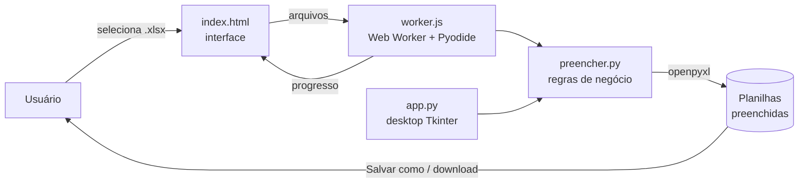

# Automação de Planilhas · EFD-REINF

[](https://lucasbatistax.github.io/automacao_planilhas/)


Ferramenta que preenche automaticamente as planilhas de **Controle EFD-REINF Mensal** a partir dos relatórios **UneCont – Serviços Tomados**. Ela processa várias empresas de uma vez, preserva o tema, a formatação e as fórmulas das planilhas de destino e roda direto no navegador, sem instalação e sem enviar dados a nenhum servidor.

**Acesse:** https://lucasbatistax.github.io/automacao_planilhas/

---

## Sumário
- [Principais recursos](#principais-recursos)
- [Como usar](#como-usar)
- [Regras de preenchimento](#regras-de-preenchimento)
- [Privacidade e segurança](#privacidade-e-segurança)
- [Arquitetura](#arquitetura)
- [Desenvolvimento](#desenvolvimento)
- [Limitações conhecidas](#limitações-conhecidas)
- [Roadmap](#roadmap)

---

## Principais recursos

| Recurso | Descrição |
|---|---|
| **Processamento em lote** | Selecione várias planilhas de origem e de destino de uma vez. |
| **Pareamento automático** | Liga cada origem ao seu destino pelo **CNPJ da empresa**, sem depender do nome do arquivo. |
| **Filtro por DARF** | Só são transferidas as notas com valor na coluna **DARF** da origem. |
| **Aba por mês** | Cada nota vai para a aba do mês correspondente. Se a aba não existir, ela é **criada com o mesmo design**. |
| **Formatação preservada** | Tema, estilos, mesclagens e fórmulas do destino são mantidos. As linhas novas usam a formatação da primeira linha de dados. |
| **Sem duplicidade** | Notas que já estão na aba são identificadas e puladas. |
| **"Não houve reinf"** | Meses sem nenhuma nota com DARF são marcados automaticamente. |
| **Progresso em tempo real** | Barra geral e barra por arquivo, com log detalhado de cada nota. |
| **Salvar onde quiser** | Ao terminar, abre a janela de salvar do sistema. Também é possível baixar os arquivos individualmente ou em `.zip`. |

---

## Como usar

1. Acesse **https://lucasbatistax.github.io/automacao_planilhas/** (Chrome ou Edge recomendados).
2. Aguarde o botão mudar de *"Carregando o motor Python…"* para **"Executar preenchimento"**. Isso leva alguns segundos e só acontece no primeiro acesso.
3. Em **Planilhas de origem**, clique em *Escolher planilhas* e selecione os relatórios UneCont. Use `⌘`/`Ctrl` para marcar vários.
4. Em **Planilhas de destino**, selecione as planilhas de Controle EFD-REINF.
5. Confira a tabela **Pares encontrados**:
   - `pronto`: o par será processado;
   - `sem par`: não há destino com o mesmo CNPJ e o arquivo será pulado;
   - `conflito`: há mais de um destino com o mesmo CNPJ e o arquivo será pulado;
   - `erro`: o arquivo não pôde ser lido.
6. Clique em **Executar preenchimento** e acompanhe o progresso.
7. Ao final, escolha onde salvar. Com uma planilha, abre o *Salvar como*. Com várias, abre a seleção de pasta.

> Os arquivos originais **nunca são alterados**. Se já existir um arquivo com o mesmo nome na pasta escolhida, o resultado é salvo como `nome_preenchido.xlsx`.

---

## Regras de preenchimento

### Pareamento origem × destino
| Planilha | Onde o CNPJ é lido |
|---|---|
| Origem (UneCont) | Coluna `Cnpj Empresa` |
| Destino (Controle) | Título da primeira aba, linha 2 (`EMPRESA LTDA - CNPJ 00.000.000/0000-00`) |

A comparação considera apenas os dígitos do CNPJ. Um destino pode receber várias origens (por exemplo, janeiro e fevereiro da mesma empresa) e, nesse caso, é aberto e salvo uma única vez.

### Seleção das notas
Uma linha da origem é transferida quando a coluna **`DARF`** possui valor diferente de zero. As linhas de total do relatório são ignoradas.

### Mapeamento de colunas
| Destino | Campo | Origem |
|:---:|---|---|
| **B** | Nota Fiscal | `Número NFe` |
| **C** | Data da NFS-e | `Data Competência` |
| **D** | CNPJ do Prestador | `Cnpj/Cpf Prestador` |
| **E** | Razão Social do Prestador | `Prestador` |
| **F** | Valor da NFS-e | `Valor NFe` |
| G – K | Natureza REINF, Código da Receita, Retenção, Pagamento, Vencimento | *não alteradas (preenchimento manual)* |

As colunas da origem são localizadas **pelo nome do cabeçalho**, então a ferramenta continua funcionando se o UneCont mudar a ordem das colunas.

### Aba de destino
- A aba é escolhida pelo **mês da `Data Competência`** (`JANEIRO`, `FEVEREIRO`, …), sem considerar o ano escrito no nome da aba.
- A nota é gravada na primeira linha livre entre o cabeçalho e a linha de **TOTAL**.
- Se não houver linha livre, uma nova linha é inserida antes do TOTAL e as fórmulas (`SUM`, bloco DARF) são reajustadas.
- Se a aba do mês **não existir**, ela é criada a partir da última aba de mês do arquivo, com estilos, larguras, mesclagens e fórmulas. Os dados e as datas de pagamento do modelo são limpos.

### Mês sem REINF
Quando um mês da origem não tem nenhuma nota com DARF, a célula **E6** (primeira linha de *Razão Social*) da aba daquele mês recebe o texto **`Não houve reinf`**. Isso só acontece se a aba ainda estiver vazia.

---

## Privacidade e segurança

- **Processamento 100% local:** o Python roda dentro do navegador via [Pyodide](https://pyodide.org). As planilhas não são enviadas a nenhum servidor.
- **Repositório sem dados de clientes:** o `.gitignore` bloqueia qualquer `.xlsx`, e os testes leem os dados de exemplo de uma pasta local não versionada (`fixtures/`).
- **Originais preservados:** a ferramenta grava sempre um novo arquivo e nunca sobrescreve o destino original.

---

## Arquitetura



| Arquivo | Responsabilidade |
|---|---|
| `preencher.py` | Toda a regra de negócio: leitura, filtro, pareamento, escrita, criação de abas. É compartilhado pelas versões web e desktop. |
| `index.html` | Interface web: seleção de arquivos, tabela de pares, progresso e salvamento. |
| `worker.js` | Carrega o Pyodide em um Web Worker para que a página não trave durante o processamento. |
| `app.py` | Interface desktop (Tkinter), empacotável como aplicativo macOS. |
| `test_preencher.py` | Testes automatizados das regras de preenchimento. |

---

## Desenvolvimento

### Requisitos
- Python **3.12+** (com Tk 8.6+ para a versão desktop)
- `openpyxl` (veja `requirements.txt`)

### Ambiente
```bash
python3 -m venv .venv
.venv/bin/pip install -r requirements.txt
```

### Versão web local
```bash
python3 -m http.server 8000
```
Depois abra http://localhost:8000.

### Versão desktop
```bash
.venv/bin/python app.py
```

Para gerar o aplicativo macOS (`dist/Preenchimento REINF.app`):
```bash
.venv/bin/pip install pyinstaller
.venv/bin/python -m PyInstaller --noconfirm --windowed --name "Preenchimento REINF" app.py
```

### Testes
Os testes usam planilhas reais de exemplo, que **não são versionadas**. Coloque-as em:
```
fixtures/origem.xlsx    # relatório UneCont - Serviços Tomados
fixtures/destino.xlsx   # Controle EFD-REINF Mensal
```
e execute:
```bash
.venv/bin/python test_preencher.py
```

### Publicação
O site é servido pelo **GitHub Pages** a partir da branch `main` (raiz). Cada push na `main` atualiza o site automaticamente.

---

## Limitações conhecidas

- **Escolher o local de salvamento** depende da *File System Access API*, disponível no Chrome e no Edge. No Safari e no Firefox os arquivos vão para a pasta *Downloads*.
- **Primeiro acesso:** o Python (~10 MB) é baixado e depois fica em cache.
- **Mesmo CNPJ em dois destinos:** se dois arquivos de destino tiverem o mesmo CNPJ (ex.: 2025 e 2026), eles são marcados como *conflito* e pulados.
- **Título das abas criadas:** abas criadas automaticamente mantêm o título de ano da aba usada como modelo.
- **Metadados do SharePoint:** os metadados `customXml` do arquivo de destino não são preservados pelo `openpyxl`. Isso não afeta o conteúdo.

---

## Roadmap

- [ ] Preenchimento automático das colunas G (Natureza REINF), H (Código da Receita) e I (Retenção)
- [ ] Pareamento manual para arquivos sem correspondência
- [ ] Atualização do título de ano nas abas criadas
- [ ] Executável para Windows
